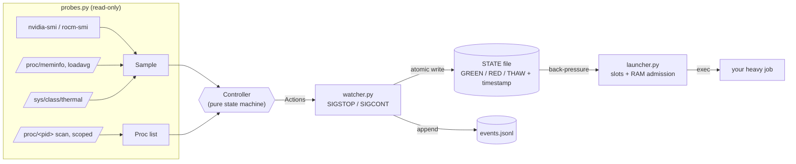
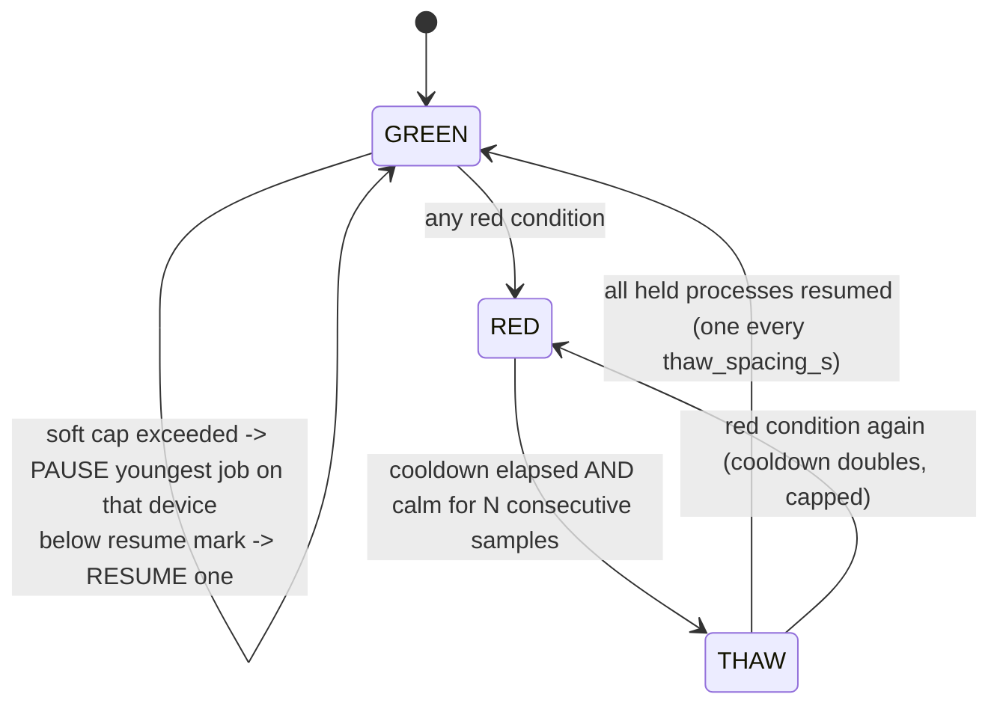

# Architecture

`server-guardrails` is three small parts that share one **state file**.

## Design rules

1. **Pause, never kill.** The only signals ever sent are `SIGSTOP` and `SIGCONT`. A frozen process keeps its memory and file handles; thawing resumes it exactly where it stopped. Jobs must therefore be safe to stall, which almost every compute job is.
2. **Fractions, not watts.** Every threshold is a fraction of detected capacity (a card's own power limit, total RAM), so one profile fits different hardware. Absolute values (temperatures) are in the config.
3. **The decision logic is pure.** `Controller.step(sample, procs, now) -> actions` does no I/O and reads no clock, so the whole state machine is unit-tested with synthetic samples (`tests/test_controller.py`).
4. **The state file is the contract.** Anything (a launcher, a scheduler, a CI step) can read `GREEN|RED|THAW <iso time>`. A file older than `state_max_age_s` means the watcher is dead, and every well-behaved consumer treats that as *not green*.
5. **Fail safe.** On SIGTERM the watcher thaws everything it froze, so stopping the guard never leaves jobs frozen. If the watcher dies, new jobs queue instead of starting.

## State machine

| Level | Trigger (defaults) | Action |
|---|---|---|
| Soft | device power > 70% of its limit, temp >= 80 C, RAM > 50% | pause the **youngest** job on that device (old jobs finish first); resume below 48% / 72 C / 42% |
| RED | any device > 95% of limit, (multi-device only) summed power > 76% of summed limits, temp >= 84 C, RAM > 56%, load > 4 per core | freeze **every** in-scope process |
| THAW | calm (temps < resume mark, summed power < 40% of capacity, RAM < resume) for 15 samples after the cooldown | resume oldest first, one per 8 s (staggered, no inrush spike) |

**Duty cycling is the power cap.** Without root you cannot lower a GPU's hardware power limit, so the soft cap pauses and resumes a job in short bursts. If a job draws `P_on` while running and `P_idle` while stopped, a duty cycle `d` gives an average of `d*P_on + (1-d)*P_idle`; choose `d` so the average stays under the cap. If you *can* set a hardware limit (`nvidia-smi -pl`), do that too: it reacts in microseconds, the software cap in seconds.

**Why the RED cooldown doubles.** A RED that recurs right after a thaw means the load itself is too high, not a transient. Doubling (default 120 s, cap 30 min) stops the guard from oscillating; 30 quiet minutes in GREEN reset the counter.

## Scope: which processes may be paused

A process is eligible only if all hold: its command line matches `include_cmd_regex` (python, java, ffmpeg, ...), does not match `exclude_cmd_regex` (the guard itself, sshd, your editor/agent shell), and it is inside the scope (`cwd` under a root, or owned by listed users, or `all`). Interactive shells are never matched by default, so your own terminal never freezes.

## Launcher (admission control)

`guardrails run <cpu|gpuN> [--ram GiB] -- cmd` does, in order: take a free slot (`flock`, one job per GPU by default, N for CPU), wait for the watcher to read GREEN and fresh, wait for RAM headroom (`used + job_ram <= ram_admission_frac * total`), pin thread counts and `CUDA_VISIBLE_DEVICES`, lower CPU/IO priority, then `exec` the job so the slot lock lives exactly as long as the job. Jobs queue; nothing is killed.

## What it does not do

- It cannot prevent a power spike shorter than its sample interval (default 1 s). The hardware limit and PSU headroom are the real first line of defence.
- It does not manage other users' processes unless you widen the scope (and have permission to signal them).
- It does not measure CPU package power unless the platform exposes it; CPU pressure is guarded through load average, temperature and RAM.
- AMD support is best-effort and experimental; NVIDIA is the tested path.
